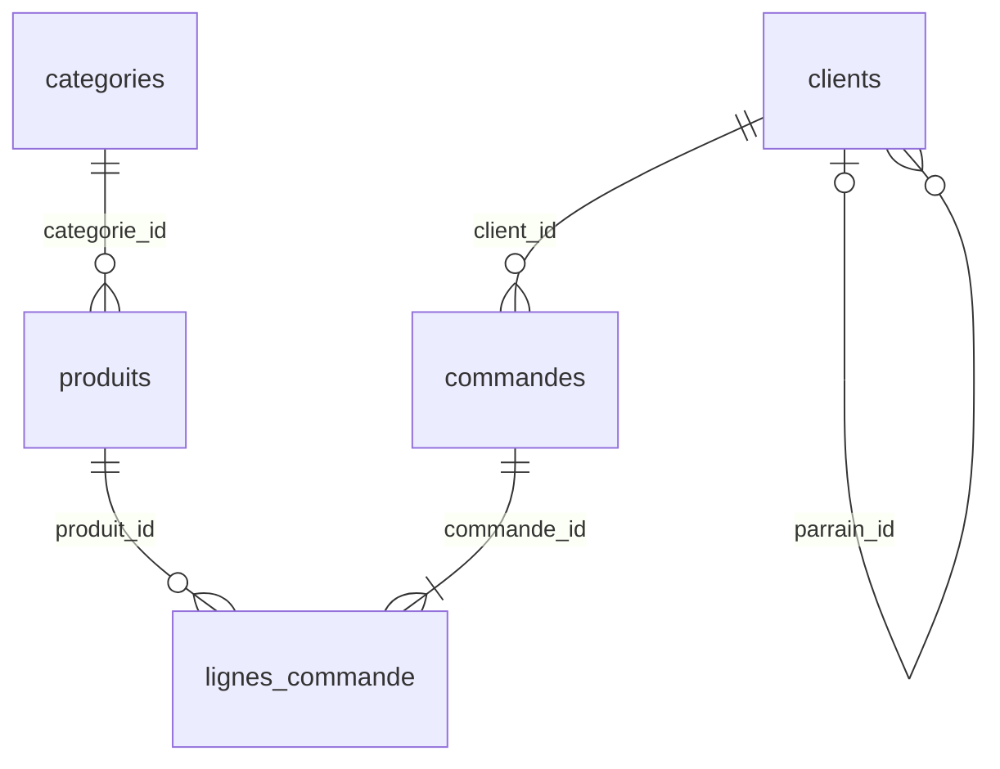

# Requêt'R — Schéma de la base de démonstration « boutique »

Document de référence des lots de contenu : c'est ici qu'on lit **quelle ligne porte quel piège** avant d'écrire un exercice.
Les données sont dans `src/seed.sql` ; `node verifier-seed.mjs` rejoue tous les contrôles ci-dessous contre ce fichier (71 critères, dont le contrôle de gel).
**Le seed est gelé** depuis la validation du lot 2 (DECISIONS.md D025, empreinte SHA-256 contrôlée par le vérificateur) : toute modification passe par une nouvelle décision, puis par le vérificateur et, à partir du lot 5, par l'Autotest.

## 1. Vue d'ensemble

Une boutique en ligne fictive, 5 tables, **289 lignes** (7 + 30 + 40 + 70 + 142), seed de 13,3 Ko. Domaine volontairement banal : l'apprenant retrouve ses repères d'un cours SQL à l'autre. Noms de tables et de colonnes en français (le public est francophone et débute au niveau 0).

Toutes les données sont **fictives** (adresses en `@exemple.test`, domaine réservé).

## 2. Date de référence

> **« Aujourd'hui » vaut toujours le 30 juin 2026 (`'2026-06-30'`)** dans tous les exercices sur les délais, retards, ancienneté.

Cette date n'est **pas dans la base** : les consignes l'écrivent en littéral et l'apprenant écrit `'2026-06-30'`. Aucun exercice, aucune solution ne contient `date('now')`, `datetime('now')`, `CURRENT_TIMESTAMP` ni `random()` (D001). Une requête d'apprenant qui en contient sera détectée par le comparateur avec un message dédié (D022, lot 3).
La dernière commande date du 2026-06-29 ; aucune date de la base n'est postérieure au 2026-06-30.

## 3. Les tables

### `categories` — les rayons du catalogue (7 lignes)
| Colonne | Type | Remarque |
|---|---|---|
| `id` | INTEGER, **PK** | 1 à 7 |
| `nom` | TEXT, NOT NULL, UNIQUE | Informatique, Maison, Cuisine, Sport, Livres, Jouets, **Jardin** (sans produit) |

### `produits` — les articles en vente (30 lignes)
| Colonne | Type | Remarque |
|---|---|---|
| `id` | INTEGER, **PK** | 101 à 130 |
| `nom` | TEXT, NOT NULL | |
| `categorie_id` | INTEGER, NOT NULL, **FK** → `categories.id` | |
| `prix` | REAL, NOT NULL, > 0 | prix **actuel** ; multiple de 0,25 ; de 3,50 à 1 299,00 |
| `stock` | INTEGER, NOT NULL, ≥ 0 | 0 pour le seul produit 114 |

Répartition : Informatique 8 (101-108), Maison 6 (109-114), Cuisine 5 (115-119), Sport 5 (120-124), Livres 4 (125-128), Jouets 2 (129-130), Jardin 0.

### `clients` — les personnes qui ont un compte (40 lignes)
| Colonne | Type | Remarque |
|---|---|---|
| `id` | INTEGER, **PK** | 201 à 240, par ordre d'inscription |
| `prenom`, `nom` | TEXT, NOT NULL | un homonyme : deux « Martin » (202 Nolan, 226 Eva) |
| `email` | TEXT, NOT NULL, UNIQUE | `prenom.nom@exemple.test`, ASCII |
| `ville` | TEXT, **peut être NULL** | 4 NULL : 205, 211, 223, 230 ; 6 clients à Lyon |
| `date_inscription` | DATE, NOT NULL | de 2024-03-12 à 2026-05-21 |
| `parrain_id` | INTEGER, **peut être NULL**, **FK** → `clients.id` | auto-référence ; 9 renseignés, 31 NULL |

### `commandes` — un panier validé (70 lignes)
| Colonne | Type | Remarque |
|---|---|---|
| `id` | INTEGER, **PK** | 1001 à 1070, par ordre chronologique |
| `client_id` | INTEGER, NOT NULL, **FK** → `clients.id` | |
| `date_commande` | DATE, NOT NULL | de 2025-01-06 à 2026-06-29 |
| `statut` | TEXT, NOT NULL, CHECK | `en_preparation`, `expediee`, `livree`, `annulee`, `retournee` |
| `frais_port` | REAL, NOT NULL, ≥ 0 | frais de la commande **entière**, comptés une seule fois (voir §6) |
| `date_livraison` | DATE, **peut être NULL** | renseignée seulement pour `livree` et `retournee` |
| `note` | INTEGER, **peut être NULL**, CHECK 1 à 5 | satisfaction ; 32 notes, 38 NULL |

### `lignes_commande` — un produit dans une commande (142 lignes)
| Colonne | Type | Remarque |
|---|---|---|
| `commande_id` | INTEGER, NOT NULL, **FK** → `commandes.id` | |
| `produit_id` | INTEGER, NOT NULL, **FK** → `produits.id` | |
| `quantite` | INTEGER, NOT NULL, > 0 | de 1 à 6 |
| `prix_unitaire` | REAL, NOT NULL, > 0 | prix **facturé** à l'époque ; peut différer de `produits.prix` (22 lignes) |
| | **PK composée** `(commande_id, produit_id)` | table de liaison : un produit apparaît au plus une fois par commande |

## 4. Carte des relations

```
categories ─1──N─ produits ─1──N─ lignes_commande ─N──1─ commandes ─N──1─ clients ◀─┐
                              (table de liaison : relation N–N)                       └─ parrain_id
```



5 clés étrangères, **réellement déclarées et appliquées** (`PRAGMA foreign_keys = ON` en tête du seed, désactivé par défaut dans sql.js : D019). Conséquences visibles par l'apprenant : insérer une commande pour un client inexistant échoue (`FOREIGN KEY constraint failed`) ; supprimer une table référencée est refusé.
Chaîne de 5 tables : des jointures à 2, 3, 4 puis 5 tables sont possibles sans table superflue.

## 5. Conventions

- **Identifiants en ASCII, snake_case.** SQLite ne replie la casse que sur l'ASCII et un accent à saisir bloque un débutant. Les valeurs énumérées (`statut`) sont en ASCII (`annulee`, pas `annulée`).
- **Plages d'identifiants disjointes** : catégories 1-7, produits 101-130, clients 201-240, commandes 1001-1070 (D013). Une jointure sur les mauvaises colonnes (`clients.id = commandes.id`) donne un résultat **vide**, donc détectable, au lieu d'un résultat plausible mais faux. Identifiants écrits en dur, jamais auto-générés.
- **Montants = multiples de 0,25** (`prix`, `frais_port`, `prix_unitaire`) : **écart assumé au réel** (D016). Pas de 9,99 : il n'existe pas ici de prix en `,99`. En échange, tout `SUM` de montants est **exact** en binaire (pas de `59.97000000000001`), et le comparateur n'a aucune tolérance à prévoir sur les sommes. Les `AVG` restent le lieu où les décimales apparaissent, donc où `ROUND` s'enseigne.
- **Dates en texte `AAAA-MM-JJ`**, type déclaré `DATE` (affinité NUMERIC : la valeur reste du texte). Aucun horaire. Les comparaisons de dates sont des comparaisons de texte, valables parce que le format est ordonné.
- **Accents** : autorisés dans les noms, prénoms, villes, produits, **à condition que `ORDER BY` (tri binaire) donne l'ordre alphabétique attendu** : pas d'accent en initiale, et aucun accent en deuxième position qui ferait passer un mot après ses voisins (« Cordon HDMI » et non « Câble HDMI », « Lise » et non « Léa », « Thomas » et non « Théo »). Vérifié par le contrôle C14l. **Limite connue** : `UPPER`, `LOWER` et `LIKE` ne gèrent que l'ASCII dans SQLite.
- **Prix facturé et prix actuel** : les lignes antérieures au 2025-10-01 peuvent porter un ancien prix ; à partir du 2025-10-01, toute ligne est au prix actuel.
- **Frais de port** : règle appliquée à toutes les commandes, annulées comprises : **4,50** si le total des produits de la commande est inférieur à 50, **6,50** de 50 à 119,99, **0** à partir de 120.

## 6. Statuts et invariants

| Statut | Nb | Sens | `date_livraison` | `note` |
|---|---:|---|---|---|
| `livree` | 46 | reçue par le client | renseignée | 27 notes sur 46 |
| `retournee` | 5 | livrée puis renvoyée | renseignée | toujours 1 ou 2 |
| `expediee` | 5 | partie, pas encore reçue | NULL | NULL |
| `en_preparation` | 3 | payée, pas encore partie | NULL | NULL |
| `annulee` | 11 | abandonnée | NULL | NULL |

Invariants, vérifiés par `verifier-seed.mjs` (0 violation) : `date_livraison` renseignée ⇔ statut `livree` ou `retournee` ; `note` renseignée seulement pour `livree`/`retournee` ; inscription ≤ commande ≤ livraison ≤ 2026-06-30 ; un parrain est inscrit avant son filleul ; toute commande a au moins une ligne ; règle des frais de port ; dates valides ; montants multiples de 0,25 ; `PRAGMA foreign_key_check` vide.

## 7. Définitions de vocabulaire (à reprendre mot pour mot dans les consignes)

> Sur 120 exercices, une ambiguïté de vocabulaire coûte cher. **Toute consigne qui parle d'argent dit explicitement lequel des deux termes elle demande.**

- **Chiffre d'affaires produits** = somme de `quantite × prix_unitaire` des lignes dont la commande n'est **ni `annulee` ni `retournee`**. Il **exclut `frais_port`**, et cette exclusion est invisible dans le mot « chiffre d'affaires », d'où le nom complet.
  Valeur de référence sur toute la base : **12 387,00** (2025 : 9 022,50 ; 2026 : 3 364,50).
- **Chiffre d'affaires total** = chiffre d'affaires produits **+ `frais_port` des mêmes commandes** (celles qui ne sont ni `annulee` ni `retournee`), les frais étant comptés **une fois par commande**.
  Valeur de référence : 12 387,00 + 232,00 = **12 619,00**. Piège : le calculer après une jointure sur `lignes_commande` donne **12 911,50** (frais de port comptés une fois par ligne).
- **Quantité vendue** d'un produit = somme de `quantite` des lignes dont la commande n'est pas `annulee` (les retours comptent) : la consigne le précise.
- Un exercice « réfléchir à ce qu'on inclut » demande explicitement une autre définition (tous statuts : 16 233,50 ; hors annulées : 12 724,50 ; livrées seules : 11 490,00).

## 8. Recensement des pièges pédagogiques

Chaque piège est **réellement présent** : `verifier-seed.mjs` rejoue la requête de contrôle. Les identifiants cités sont ceux à utiliser pour construire un exercice.

| # | Piège | Porté par | Contrôle (requête → résultat) | Enseigne |
|---|---|---|---|---|
| **P1** | Clients sans commande | **215, 222, 228, 236, 239, 240** (6). Clients dont **toutes** les commandes sont annulées : **219** (1005, 1058) et **232** (1034) | `… WHERE id NOT IN (SELECT client_id FROM commandes)` → 6 ; `COUNT(DISTINCT c.id)` en `JOIN` → **34**, en `LEFT JOIN` → **40** ; `LEFT JOIN … WHERE o.statut='livree'` → **27**, même filtre en `ON` → **40** ; pour le client 215 : `COUNT(*)` = **1**, `COUNT(o.id)` = **0** | `LEFT` ≠ `INNER` ; anti-jointure (`IS NULL`, `NOT EXISTS`) ; filtre en `WHERE` (qui annule le `LEFT JOIN`) contre filtre en `ON` ; `COUNT(*)` ≠ `COUNT(col)` après jointure |
| **P2** | Produits jamais commandés ; catégorie vide | Jamais commandés : **114, 115, 120, 125, 130** (5). Commandé **uniquement** dans des commandes annulées : **109** (1016, 1058). Catégorie sans produit : **7 Jardin** | `produits LEFT JOIN lignes_commande … WHERE l.produit_id IS NULL` → 5 ; `categories LEFT JOIN produits … WHERE p.id IS NULL` → « Jardin » | `LEFT JOIN` en cascade ; « jamais commandé » ≠ « jamais vendu » ; `HAVING COUNT(...) = 0` |
| **P3** | NULL dans plusieurs colonnes | `clients.ville` (205, 211, 223, 230) ; `clients.parrain_id` (31 NULL) ; `commandes.date_livraison` (19 NULL) ; `commandes.note` (38 NULL) | `COUNT(*), COUNT(ville), COUNT(parrain_id)` → 40, 36, 9 ; `COUNT(note)` → 32 ; `AVG(note)` = **3,75** contre `SUM(note)/COUNT(*)` = **1,714…** ; `ville <> 'Lyon'` → **30** (et non 34) ; `GROUP BY ville` → un groupe NULL ; `AVG(delai)` sur `date_livraison` : 51 livrées sur 70 | `COUNT(col)` ≠ `COUNT(*)` ; `AVG` ignore les NULL ; `<>` ne ramène pas les NULL ; `IS NULL` ; `COALESCE` ; groupe NULL ; NULL et `ORDER BY` |
| **P4** | Commandes à plusieurs lignes | **51** commandes à ≥ 2 lignes sur 70 (19 à une seule), maximum **5** lignes (1043) ; `frais_port` non nul sur les petits paniers | `SUM(frais_port)` direct → **306,50** ; après `JOIN lignes_commande` → **636,00** ; `COUNT(*)` après jointure → **142** pour 70 commandes | **Gonflement du `SUM` après jointure** ; `COUNT(DISTINCT)` ; agréger avant de joindre |
| **P5** | Ex æquo sur un classement | (a) `prix` : **1 299** partagé par 101 et 109, **449** par 102 et 103, **29** par 111 et 129 ; en catégorie Informatique, 102 et 103 se partagent le **rang 2**. (b) chiffre d'affaires produits par client : **220 et 229** à égalité (**1 357,00**) au **rang 3**. (c) quantité vendue : **126 et 128** à égalité (**10**) au **rang 4**. (d) **18** clients ont exactement 2 commandes | prix : `RANK` 1,1,3 · `DENSE_RANK` 1,1,2 · `ROW_NUMBER` 1,2,3 ; Informatique : `RANK` 1,2,2,4 ; clients : `RANK` 1,2,3,3,5 · `DENSE_RANK` 1,2,3,3,4 | `ROW_NUMBER` / `RANK` / `DENSE_RANK` ; `LIMIT 1` qui cache un ex æquo ; `PARTITION BY` ; ordre total obligatoire (D001) |
| **P6** | Dates sur ≥ 2 années civiles | 2025 : **44** commandes ; 2026 : **26** ; **aucune commande en 2025-08** (17 mois sur 18) ; **1044** le 2025-12-31 et **1045** le 2026-01-01 ; clients inscrits en 2024, 2025, 2026 ; 1er semestre 2025 : 3,3,4,3,4,5 ; 1er semestre 2026 : 4,2,5,4,3,8 | `strftime('%Y', …)` → 44 / 26 ; `COUNT(DISTINCT strftime('%Y-%m', …))` → **17** ; commandes du 2025-12-31 et du 2026-01-01 → 2 | `strftime`, `GROUP BY` année / mois, comparaison N / N−1, **`LAG` compare à la ligne précédente, pas au mois précédent** (le trou d'août le montre), bornes de `BETWEEN` |
| **P7** | Statuts variés | `annulee` 11, `en_preparation` 3, `expediee` 5, `livree` 46, `retournee` 5 | `GROUP BY statut` → ces 5 lignes ; CA tous statuts **16 233,50** > hors annulées **12 724,50** > livrées **11 490,00** | `WHERE` à sens métier ; `IN` ; `<> 'annulee'` ramène les `retournee` ; **définition du chiffre d'affaires** (§7) |
| **P8** | Montants variés | 27 prix distincts (3,50 à 1 299,00) ; quantités 1, 2, 3, 4, 6 ; `frais_port` ∈ {0 ; 4,50 ; 6,50} | `HAVING SUM(quantite*prix_unitaire) > 500` (hors annulées/retournées) → **7** clients sur les 32 qui ont au moins une commande valide | `SUM`, `AVG`, `HAVING` qui sépare réellement les groupes ; **division entière** (`SUM(quantite) / COUNT(*)` tronque en SQLite) |
| **P9** | `parrain_id` (hors brief initial, D015) | 9 parrainages ; chaîne **201 → 203 → 206 → 214** (4 niveaux) ; 205 → 209 → 225 ; 9 parrains distincts | `id NOT IN (SELECT parrain_id FROM clients)` → **0** ; `NOT EXISTS` → **31** ; `WITH RECURSIVE` → profondeur max **4** | Auto-jointure ; **`NOT IN` + NULL** ; CTE récursive (**bonus** du palier 5, jamais exigée) |
| **P10** | Prix facturé ≠ prix actuel (hors brief) | **22** lignes, toutes avant 2025-10-01 (ex. 1001 : portable à 1 249,00 pour un prix actuel de 1 299,00 ; 1004 : tablette à 479,00 pour 449,00) | `l.prix_unitaire <> p.prix` → 22 | Chiffre d'affaires au prix facturé contre au prix actuel |
| **P11** | Retards (hors brief) | Au 2026-06-30, 5 commandes `expediee` : **1062** (2026-05-27, 34 jours), **1064** (2026-06-12, 18 jours), 1065, 1066, 1067 (3 à 6 jours) ; 3 `en_preparation` (1068-1070) ; délais de livraison de **2 à 12 jours** | `statut='expediee' AND julianday('2026-06-30') − julianday(date_commande) > 10` → **2** ; délai moyen des 51 commandes livrées : **4,37 jours** | Arithmétique de dates par rapport à une date fixe ; `AVG` des délais (NULL ignorés) |

## 9. Matrice de couverture : clause → piège → lignes porteuses

Programme des paliers : DECISIONS.md D021.

| Palier | Clause ou notion | Piège / support | Lignes porteuses |
|---|---|---|---|
| **P1 Lire** | `WHERE` sur texte, nombre, date | `produits.prix`, `clients.ville`, `commandes.date_commande` | toutes les tables |
| | `ORDER BY` (dont tri multiple) | ex æquo de prix (P5a) → un second critère s'impose ; noms triés sans surprise d'accent | produits 101/109, 102/103, 111/129 |
| | `LIMIT` | `LIMIT 1` qui cache un ex æquo (P5a) | produits 101 et 109 |
| | `DISTINCT` | villes, statuts, dates | `clients.ville` (NULL inclus), `commandes.statut` |
| | alias | colonnes calculées `quantite * prix_unitaire` | `lignes_commande` |
| | `IS NULL`, `<>` et NULL | P3 | clients 205, 211, 223, 230 ; commandes 1005… |
| | `IN`, `BETWEEN`, `LIKE` | statuts, dates ; `LIKE` limité à l'ASCII | `commandes.statut`, `date_commande` |
| **P2 Agréger** | `COUNT(*)` / `COUNT(col)` | P3 | `clients.ville`, `parrain_id` ; `commandes.note` |
| | `SUM`, `AVG`, `MIN`, `MAX` | P8 ; `AVG` ignore les NULL | `lignes_commande`, `commandes.note` |
| | `GROUP BY`, `HAVING` | clients > 500 (P8), catégories par nombre de produits | `lignes_commande`, `produits` |
| | `CASE WHEN` | tranches de prix, de note, de statut | `produits.prix`, `commandes.note` |
| | fonctions de date | `strftime`, `julianday`, trou d'août, frontière d'année (P6) | commandes 1044, 1045 ; mois 2025-08 |
| | division entière | `SUM(quantite) / COUNT(*)` (P8) | `lignes_commande.quantite` |
| **P3 Croiser** | `INNER JOIN`, `LEFT JOIN` | P1, P2 | clients sans commande ; produits jamais commandés ; Jardin |
| | jointures multiples | chaîne `categories → produits → lignes_commande → commandes → clients` | 5 tables |
| | anti-jointure | `LEFT JOIN … IS NULL`, `NOT EXISTS` | P1, P2 |
| | **gonflement du `SUM`** | `frais_port` répété par ligne (P4) : 306,50 → 636,00 | commandes à ≥ 2 lignes (51) |
| | **NULL après jointure** | `COUNT(*)` contre `COUNT(o.id)` ; client 215 : 1 contre 0 | clients sans commande |
| | **`WHERE` contre `ON`** | filtre `statut='livree'` : 27 contre 40 | clients, commandes |
| | auto-jointure | « qui a parrainé qui » (P9) | clients 203/201, 206/203, 214/206 |
| **P4 Raisonner** | sous-requêtes, dont **corrélées** | commandes au-dessus de la moyenne du client ; dernier achat d'un client | clients à ≥ 2 commandes (18) |
| | `NOT IN` + NULL | P9 → 0 ligne contre 31 | `clients.parrain_id` |
| | CTE | agréger avant de joindre (corrige P4) | `lignes_commande` |
| | `ROW_NUMBER`, `RANK`, `DENSE_RANK` | P5 (a)(b)(c) | produits 101/109, 102/103 ; clients 220/229 ; produits 126/128 |
| | `LAG` | évolution mensuelle, trou d'août (P6) | commandes par mois, 17 mois |
| | `SUM() OVER` (cumul) | chiffre d'affaires cumulé par mois | `commandes` + `lignes_commande` |
| | top-N par groupe | meilleur produit par catégorie, ex æquo compris | `produits` (rang 2 partagé en Informatique) |
| **P5 Métier** | question métier floue | « le chiffre d'affaires » (§7), « client actif » au 2026-06-30 | P7, P11 |
| | données sales, contrôles de cohérence | **second jeu de données, séparé de ce seed** (D027, pas encore construit) ; les invariants du §6 servent de modèle de ce qu'on contrôle | hors de ce seed |
| | `UNION`, `INTERSECT`, `EXCEPT` | clients ayant commandé en 2025 contre en 2026 | commandes 2025 / 2026 |
| | CTE récursive (**bonus**) | chaîne de parrainage 201 → 203 → 206 → 214 | clients (P9) |

## 10. À refaire à la main (critère C16)

**Commande 1038** (client 210 Chloé Simon, livrée le 2025-12-04, note NULL) :

| produit | quantité | prix unitaire | ligne |
|---|---:|---:|---:|
| 110 Lampe de bureau | 1 | 34,00 | 34,00 |
| 111 Plaid en laine | 1 | 29,00 | 29,00 |
| 112 Cadre photo | 2 | 12,50 | 25,00 |
| 113 Bougies chauffe-plat | 4 | 3,50 | 14,00 |

Total des produits : 34 + 29 + 25 + 14 = **102,00** (inférieur à 120, supérieur à 50, donc frais de port **6,50**) ; **total payé : 108,50**.
Requête de contrôle : `SELECT SUM(quantite * prix_unitaire) FROM lignes_commande WHERE commande_id = 1038;` → **102**.

## 11. Ce que le jeu ne permet pas d'enseigner

À connaître **avant** d'écrire des exercices :

- **Données sales : il n'y en a aucune, et c'est voulu.** Pas de doublon d'e-mail ni de client en double, pas de casse ou d'espaces incohérents, pas de statut hors liste, pas de date impossible, aucune violation d'invariant : les contrôles du §6 renvoient 0 ligne, et aucune consigne n'a jamais à écrire « sauf la ligne 217 ». Le palier 5 (« données sales », « contrôles de cohérence ») s'appuie sur un **second jeu de données, séparé**, qui n'existe pas encore et naîtra au lot du palier 5 (**D027**, Q4 résolue) : un export brut à nettoyer avant l'analyse, comme en entreprise. Il se chargera à la place de ce seed par `nouvelleBase(seed)`. Les anomalies y seront listées avec leur propre vérificateur ; celui de ce seed reste sans exception.
- `FULL JOIN` utile : aucune ligne orpheline (clés étrangères obligatoires). Hors programme (D021).
- Tris sur initiales accentuées, `UPPER` / `LIKE` sur des lettres accentuées : volontairement écartés.
- Heures, fuseaux : aucune colonne n'a d'horaire.
- `INSERT` / `UPDATE` / `DELETE` / `CREATE` : hors programme principal (D021) ; la base se reconstruit à chaque exercice (D008).

## 12. Modifier le seed

Le seed est **gelé** à la validation du lot 2 (D025) : ~120 exercices dépendront de ses valeurs. Toute évolution : nouvelle décision dans DECISIONS.md, modification de `src/seed.sql`, `node verifier-seed.mjs` au vert, mise à jour de ce document (valeurs de référence, recensement), et rejeu de l'Autotest (lot 5) sur tous les exercices existants.
